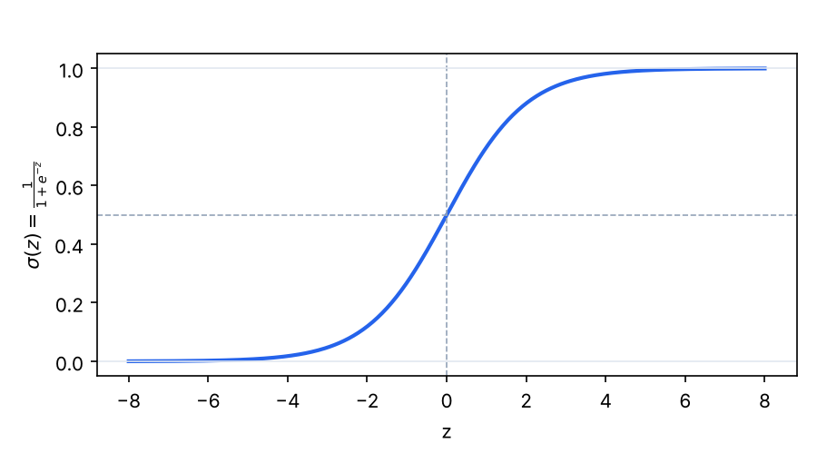
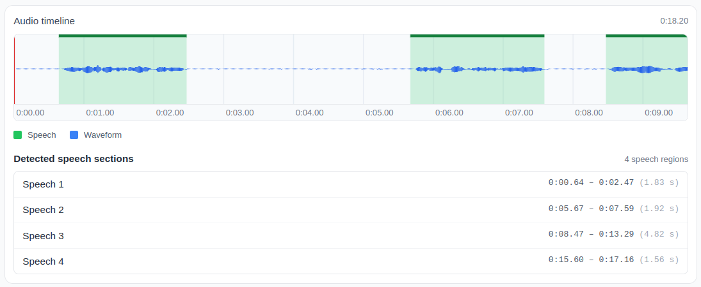

# Chapter 10: Machine Learning for Audio Processing
LibreDSP supports the basic functionalities for applying machine learning (ML) algorithms for audio processing.
Specifically, it supports classifying segments of audio recordings as speech or non-speech.
This operation is called *voice activation detection (VAD)*.
VAD detects the part of the audio that is speech, and it can distinguish it from, generally, any non-speech segment such as silence, background noise, honking sound and so on.
In the latest version of LibreDSP, VAD is performed via the [logistic regression](https://en.wikipedia.org/wiki/Logistic_regression) algorithm.
Logistic regression is a classic machine learning model that as input, receives a set of features from the audio file.
These features are extracted from the input audio file and include zero-crossing rate (ZCR), centroid, the log energy (computed from the root mean square, RMS) and so on.
To briefly mention what some of these features mean, the ZCR, which is a number between \\(0\\) and \\(1\\), tells us how rapidly the signal is crossing zero (the x axis).
For the extreme case that the signal is `[-1,1,-1,1,...]`, the ZCR computes to be \\(1\\).
For a DC signal like `[1 1 1 1]`, on the other hand it computes to be \\(0\\).
Centroid is another feature that computes the power-weighted average frequenc\\)y of the spectrum of the signal (via FFT) that tells us where the bulk of the frequency content of the signal is located at.
For slow varying signals, the centroid is near 0 radians/sample.
For fast varying signals, it is closer to \\(\pi\\).
The library extracts features like these, among other features, from the *training data*.
It then "trains" the logistic regression model meaning that it computes a set of coefficients, in vector notation denoted as \\(w\\), such that if we take the dot product of the input vector of extracted features with this vector, plus an additional constant term called the bias term, and give that as input to the logistic function, we get a value near 0 for the sections of audio denoted as non-speech and near 1 for the speech parts.
Mathematically, for each short frame of audio (25 ms long, advancing by 10 ms), assume the input is a vector below:

\\[
x = [x_1, x_2, \dots, x_7]^T = [\text{log energy}, \text{ZCR}, \text{centroid}, \text{rolloff}, \text{flatness}, \text{energy std}, \text{ZCR std}]^T
\\]

Moreover, the features have very different scales, so each one is first standardized using its mean \\(\mu_j\\) and standard deviation \\(s_j\\), both computed from the training data[^2]:
[^2]: This standardization is needed for rapid convergence to the optimal solution.
The mathematical justification comes from the eigenanalysis of the Hessian matrix of the logistic regression loss.

\\[
\tilde{x}_j = \frac{x_j - \mu_j}{s_j}
\\]

Then the expression:

\\[
y = \sigma(z), \qquad z = w_0 + \sum_{j=1}^{7} w_j \tilde{x}_j = w_0 + w^T \tilde{x}
\\]

would yield near 0 for non-speech and near 1 for speech.
Here, \\(w_0\\) is the bias and \\(\sigma\\) is the sigmoid function:

\\[
\sigma(z) = \frac{1}{1 + e^{-z}}
\\]

The sigmoid function is a function whose output (i.e. its range) is between 0 and 1 and squishes the input between \\(0\\) and \\(1\\).
Graphically, it is depicted below:

<figure style="text-align: center; display: flex; flex-direction: column; align-items: center; gap: 12px;">
  
  <figcaption>Figure 1: The sigmoid function.</figcaption>
</figure>

Because of this, \\(y\\) can be interpreted as the probability that the frame is speech[^1].
[^1]: From the *probability axioms*, the probability of `1` refers to an event with certain probability and `0` is for the one with the zero chance to occur.
A frame is classified as speech if this probability (averaged over a few neighboring frames) is above a threshold.

How are the weights for logistic regression found?
Let \\(y_i \in \{0, 1\}\\) be the label of training frame \\(i\\) (1 for speech) and \\(h_i = \sigma(w^T \tilde{x}_i)\\) the model output, where \\(\tilde{x}_i\\) has a leading 1 for the bias.
We then try to maximize the following expression:

\\[
\prod_{i=1}^{n} h_i^{\,y_i} (1 - h_i)^{1 - y_i}
\\]

Each term is the probability the model assigns to the true label of frame \\(i\\) (\\(h_i\\) for a speech frame and \\(1 - h_i\\) for a non-speech frame). Maximizing this expression means we want each individual term (probability) to be as close to 1 as possible.
The expression above is the product of many numbers below 1, so it becomes extremely close to zero.
For numerical reasons, we instead take the log of it and maximize that.
Since log is also a monotonic function, maximizing the log of the expression above is the same as maximizing the expression itself.
Therefore, the objective of logistic regression is to maximize:

\\[
\ell(w) = \sum_{i=1}^{n} \Big[ y_i \ln h_i + (1 - y_i) \ln (1 - h_i) \Big]
\\]

Using \\(\sigma'(z) = \sigma(z)\,(1 - \sigma(z))\\), its gradient is:

\\[
\nabla \ell(w) = \sum_{i=1}^{n} (y_i - h_i) \tilde{x}_i
\\]

and the weights are updated repeatedly with a step size \\(\alpha\\):

\\[
w \leftarrow w + \alpha\, \frac{1}{n} \sum_{i=1}^{n} (y_i - h_i) \tilde{x}_i
\\]

Once the logistic regression finds a set of coefficients that classifies the training data well, it can then work on new data it has never seen.
This is supported by a subject known as "learning theory".
Roughly, it tells us that if the data used in training and usage come from the same distribution (and there is enough training data), then with high probability the error on the training data is close to the error computed in practice on the new data.

Even though logistic regression is not always the most accurate algorithm, it is easy to understand, computationally light, and usually requires less data to train compared to other ML algorithms like the *artificial neural network (ANN)*.
This algorithm can also be used as a baseline to compare the efficacy of more advanced ML algorithms.

## Training Logistic Regression in LibreDSP for VAD
To train the logistic regression model for VAD, you can execute the following command:

```bash
cargo run --release --example speech_vad_train -- <your_data_folder>
```

Here, `<your_data_folder>` should contain `.wav` files alongside a corresponding `.csv` file that denotes the speech and non-speech part of the wav file.
For instance, an example of such a file could be:

```
start,end,label
0.000,7.060,speech
7.060,9.637,nonspeech
...
```
After finishing the learning process, the library produces a set of weights alongside some parameters, i.e. means and standard deviations, that are used for standardizing the data, and stores that into the `model.txt` file.
To use the calculated weights for VAD, you can run:

```
cargo run --release --example speech_vad_detect -- model.txt <recording.wav>
```

Where `<recording.wav>` is the audio recording.
You can also upload the `model.txt` file to LibreDSP Workspace and visually see the VAD on a recording.
An example of the speech vs non-speech classification via LibreDSP Workspace is depicted below:

<figure style="text-align: center; display: flex; flex-direction: column; align-items: center; gap: 12px;">
  
  <figcaption>Figure 2: LibreDSP Workspace classifying different segments of the audio as speech or non-speech.</figcaption>
</figure>


