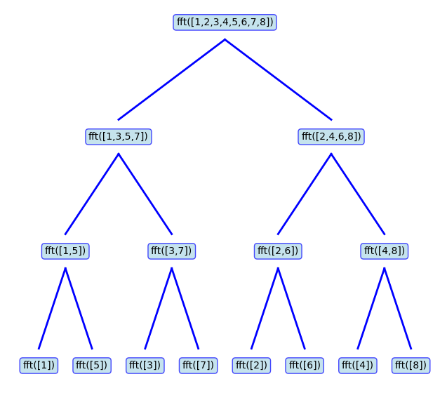

# Fast Fourier Transform (FFT)
In the previous chapter we saw that the DFS allowed us to decompose a periodic discrete-time signal and write it as a sum of complex exponentials.
As we also discussed, the computations performed for the DFS are identical to what's performed for the discrete Fourier transform (DFT).
For the DFS, we implicitly assume that the signal we apply the DFS on is periodic.
For the DFT in contrast, we assume that we have a finite sequence of numbers.
However, the computations for the two transforms are the same, and the difference is merely a conceptual one.
In this chapter, we develop our discussion for the DFT, but everything works the same for the DFS as well.

To recap, via the DFT, a signal can be written via the following expression.
\\[
x[n]=\sum_{k=0}^{N_0-1}a_ke^{jk2\pi n / N_0}
\\]
Where the coefficients \\(a_k\\)'s are computed via:
\\[
a_k=\frac{1}{N_0}\sum_{n=0}^{N_0-1}x[n]e^{-jk2 \pi n / N_0}
\\]
Notice that here we have \\(N_0\\) such coefficients, and each one requires a sum from \\(0\\) to \\(N_0-1\\) to compute.
Therefore, if we perform these operations via a computer program, we say that its time complexity is \\(O(N_0^2)\\).
The symbol \\(O\\) is called *Big O* notation, and it tells us how the complexity of the algorithm grows as a function of the input size.
For computing the coefficients of the DFS, we see that if we have \\(N_0\\) samples, then computing all \\(N_0\\) coefficients, each requiring a sum of \\(N_0\\) terms, takes \\(N_0 \times N_0 = N_0^2\\) steps. Therefore, we say the time complexity is \\(O(N_0^2)\\).
A time complexity of \\(O(N^2)\\) is generally not desirable for algorithms, and we often look for algorithms that work in linear or logarithmic complexity instead.
As it turns out, an algorithm called the ***Fast Fourier Transform*** can compute the \\(a_k\\) coefficients (and also reconstruct the signal \\(x[n]\\) from those coefficients) in \\(O(N_0 \log N_0)\\) time complexity.
This is a great improvement over a naive computation of the DFT coefficients and is used extensively in any application that requires the DFT.
In what follows, we will explore a classic variant of the FFT called ***radix-2***.

## Radix-2 FFT Algorithm
The radix-2 FFT algorithm computes the DFT of a sequence whose size is a power of 2.
Therefore, if the signal is not a power of two, we can make it such a sequence by appending zeros to the end of the sequence until its size is the next power of 2.
We now assume that the sequence \\(x[n]\\) has a size that is a power of 2.
Its DFT coefficients are, again, computed as:

\\[
a_k=\frac{1}{N_0}\sum_{n=0}^{N_0-1}x[n]e^{-j2\pi kn/N_0},
\qquad k=0,1,\ldots,N_0-1.
\\]

We can rewrite the above expression and separate the sum into two parts: one part, a sum over **even-indexed samples**, and another over **odd-indexed samples**.
\\[
a_k=
\frac{1}{N_0}\sum_{m=0}^{N_0/2-1}x[2m]e^{-j2\pi k(2m)/N_0}+
\frac{1}{N_0}\sum_{m=0}^{N_0/2-1}x[2m+1]e^{-j2\pi k(2m+1)/N_0}
\\]

Notice for the even term, we can write the exponential term as:
\\[
e^{-j2\pi k(2m)/N_0}
=e^{-j2\pi km/(N_0/2)}
\\]

For the odd term we can write:
\\[
e^{-j2\pi k(2m+1)/N_0}=
e^{-j2\pi k/N_0}e^{-j2\pi km/(N_0/2)}
\\]

Using these two substitutions, we can then write the sum as:
\\[
a_k=\frac{1}{N_0}\sum_{m=0}^{N_0/2-1}x[2m]e^{-j2\pi km/(N_0/2)}+
e^{-j2\pi k/N_0}
\frac{1}{N_0}\sum_{m=0}^{N_0/2-1}x[2m+1]e^{-j2\pi km/(N_0/2)}
\\]

If we call the first sum \\(E_k\\) and the latter one \\(O_k\\), then we have:
\\[
a_k=E_k+e^{-j2\pi k/N_0}O_k
\\]

The term \\(e^{-j2\pi k/N_0}\\) is called the *twiddle factor*.
Notice that \\(E_k\\) is closely related to **the DFT of the even samples**, and \\(O_k\\) is related to **the DFT of the odd samples**.
Specifically, the DFT of the even samples is:
\\[
D_e[k]=
\frac{2}{N_0}
\sum_{m=0}^{N_0/2-1}
x[2m]e^{-j2\pi km/(N_0/2)},
\qquad k=0,1,\ldots,N_0/2-1.
\\]

Comparing this to \\(E_k\\), we have:
\\[
E_k=\frac{1}{2}D_e[k\\bmod(N_0/2)]
\\]

The same applies for \\(O_k\\) and the DFT of the odd samples. If we denote the DFT of the odd samples as \\(D_o\\), then we have:
\\[
O_k=\frac{1}{2}D_o[k\\bmod(N_0/2)]
\\]

This means that \\(E_k\\) is the DFT of the even-indexed samples, scaled by a factor of \\(1/2\\), up to \\(k=N_0/2-1\\).
Since the DFT of a sequence of length \\(N_0/2\\) is periodic with period \\(N_0/2\\), for \\(k\\) from \\(N_0/2\\) up to \\(N_0-1\\), the DFT coefficients repeat.
The same applies to \\(O_k\\) and the DFT of the odd-indexed samples.

Therefore:
\\[
E_{k+N_0/2}=E_k
\\]
\\[
O_{k+N_0/2}=O_k
\\]

For the second half of the DFT coefficients, we replace \\(k\\) by \\(k+N_0/2\\) in
\\(a_k=E_k+e^{-j2\pi k/N_0}O_k\\). Using the above relations and
\\[
e^{-j2\pi(k+N_0/2)/N_0}
=-e^{-j2\pi k/N_0}
\\]
we obtain:

\\[
\boxed{
\begin{aligned}
a_k &= E_k+e^{-j2\pi k/N_0}O_k \\\\
a_{k+N_0/2} &= E_k-e^{-j2\pi k/N_0}O_k
\end{aligned}
}
\qquad k=0,1,\ldots,N_0/2-1.
\\]

This is a recursive definition, and it tells us that the DFT of a sequence of size \\(N_0\\) can be computed via the DFT of two sequences, each with size \\(N_0/2\\).

To see this concretely, assume we have a function called \\(fft(...)\\) that computes the FFT of the sequence that is passed to it as its argument.
The tree execution of this function would be:

<figure style="text-align: center;">
  
  <figcaption>Figure 1: The execution tree of the radix-2 FFT function for an example sequence.</figcaption>
</figure>

As the figure shows, to compute the FFT of the sequence \\([1,2,\ldots,8]\\), the program merges the results obtained by calling the FFT function on the sequences \\([1,3,5,7]\\) and \\([2,4,6,8]\\).
Also, to compute the FFT of each one, the program has to branch out further and compute the FFT of its odd- and even-indexed elements.
This recursive call continues until the program hits the **base case**, which is the task of computing the FFT of a single element.
This FFT is trivial to compute, and it's just the value itself.
To see that, \\(N_0=1\\), the only term is \\(n=0,k=0\\):
\\[
a_0=x[0]e^{-j2\pi (0)(0) / 1} = x[0]
\\]

> **Note**: It is a convention to compute the DFT coefficients in radix-2 implementations as:
> \\[
> a_k=\sum_{n=0}^{N_0-1}x[n]e^{-jk2 \pi n / N_0}
> \\]
> In this form, the formula does not have the scaling factor \\(\frac{1}{N_0}\\) before the sum (in contrast to the formula we had for the DFT).
> However, for the reconstruction of the signal, that is executing the inverse DFT, we use:
> \\[
> x[n]=\frac{1}{N_0} \sum_{k=0}^{N_0-1}a_ke^{jk2\pi n / N_0}
> \\]

The following code creates a discrete-time signal and applies the FFT on it via LibreDSP:

```rust
use libredsp::signal::Signal;

fn main() {
    let signal = Signal::new(vec![1.0, 0.0, 0.0, 0.0]);
    // Apply FFT
    let spectrum = signal.fft();
    println!("Result of the FFT: {:?}", spectrum);
}
```
The output of the code is as follows:
```
Result of the FFT: [Complex { re: 1.0, im: 0.0 }, Complex { re: 1.0, im: 0.0 }, Complex { re: 1.0, im: 0.0 }, Complex { re: 1.0, im: 0.0 }]
```