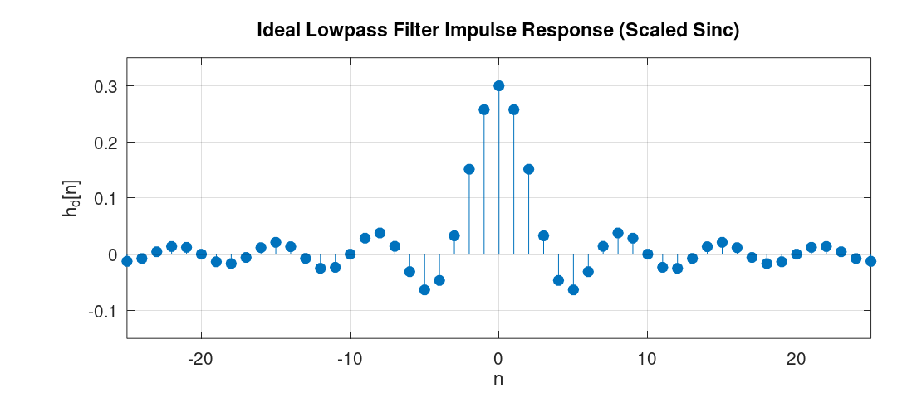

# Discrete-Time Fourier Transform (DTFT)
The DFS and DFT we discussed in [Chapter 3](./chapter_3.md) were great tools for decomposing arbitrary discrete-time signals in terms of complex exponentials.
We then saw an efficient way to compute those transforms via the FFT in [Chapter 4](./chapter_4.md).
A major limitations of the DFT and DFS though, is that the coefficients we obtain by computing those transform depend heavily on the length of signals.
In other words, the DFT and DFS operations of two signals are only comparable (and can be added and subtracted, etc) if the underlying discrete-time signals have the same length.
To overcome this limitation, we can zero-pad two arbitrary signals to have the same length, and then compute the DFT or DFS (via the FFT) for them.
For the analytical purposes though, it is often suitable to add infinite zeros, in the limit sense, and then compute the DFT or DFS.
By doing so, we obtain what's called the Discrete-time Fourier Transform (DTFT) of the signal.
In this chapter we briefly introduce this transform and then we will see how we can obtain it in LibreDSP via the FFT operation.

Let us start with an aperiodic discrete-time signal.
To obtain the DTFT of the signal, the basic idea is to construct a periodic signal by appending zeros to an aperiodic signal and then repeating that signal to make it periodic.
We then apply DFS on this periodic signal.
In this setup, as the number of appended zeros approaches infinity, the DFS becomes the DTFT.

Let \\(x[n]\\) be an aperiodic signal that is nonzero only for
\\[
N_1 \le n \le N_2.
\\]

Choose a period \\(N \ge N_2-N_1+1\\) and construct the periodic extension of \\(x[n]\\) by repeating one period that contains the entire nonzero portion of the signal. The DFS coefficients are

\\[
a_k = \frac{1}{N}\sum_{n=0}^{N-1}x[n]e^{-jk\omega_0n} = \frac{1}{N}\sum_{n=-\infty}^{\infty}x[n]e^{-jk\omega_0n} = \frac{1}{N}X(e^{j\omega_0k}),
\\]

where
\\[
\omega_0=\frac{2\pi}{N},
\\]
and \\(X(e^{j\omega})\\) is a function of \\(\omega\\) that we would call the 'DTFT'.

The synthesis equation then becomes

\\[
x[n] = \sum_{k=0}^{N-1}a_ke^{jk\omega_0n} = \frac{1}{N}\sum_{k=0}^{N-1}X(e^{j\omega_0k})e^{jk\omega_0n}.
\\]

Using the relation
\\[
\omega_0=\frac{2\pi}{N},
\\]
we obtain

\\[
x[n] = \frac{1}{2\pi} \sum_{k=0}^{N-1} X(e^{j\omega_0k}) e^{jk\omega_0n} \omega_0.
\\]

As \\(N\rightarrow\infty\\), we have \\(\omega_0\rightarrow0\\), and the sum becomes an integral:

\\[
x[n] = \frac{1}{2\pi} \int_0^{2\pi} X(e^{j\omega}) e^{j\omega n} d\omega.
\\]

In summary, an aperiodic discrete-time signal can be expressed as an integral of complex exponentials through the Discrete-Time Fourier Transform (DTFT):

**Synthesis**
\\[
\boxed{x[n] = \frac{1}{2\pi} \int_0^{2\pi} X(e^{j\omega}) e^{j\omega n} d\omega}.
\\]

**Analysis**
\\[
\boxed{X(e^{j\omega}) = \sum_{n=-\infty}^{\infty} x[n] e^{-j\omega n}}.
\\]

The **analysis** equation computes the DTFT \\(X(e^{j\omega})\\) from the signal \\(x[n]\\), while the **synthesis** equation reconstructs \\(x[n]\\) from its DTFT.

> **Note 1:** In the derivation the DTFT, this step:
>
> \\[
> x[n] = \frac{1}{2\pi} \int_0^{2\pi} X(e^{j\omega}) e^{j\omega n} d\omega
> \\]
>
> is only valid if we can expand it as:
>
> \\[
> x[n] = \frac{1}{2\pi} \int_0^{2\pi} \sum_{m=-\infty}^{\infty} x[m] e^{-j\omega m} e^{j\omega n}  d\omega = \sum_{m=-\infty}^{\infty} x[m] \left( \frac{1}{2\pi} \int_0^{2\pi} e^{j\omega (n-m)}  d\omega \right)
> \\]
> The inner integral evaluates to \\(1\\) when \\(m = n\\) and to \\(0\\) otherwise.
> This leaves only the \\(m = n\\) term in the sum, resulting in \\(x[n]\\).
>
> As we can see, the equation above requires interchanging the sum and integral.
> For discrete-time signals with finite length this is valid, but it is not for an arbitrary infinite-length signal.
> However, if a signal is ***absolutely summable***, meaning that the sum of its absolute values is finite:
>
> \\[
> \sum_{n=-\infty}^{\infty} |x[n]| < \infty
> \\]
>
> then we can safely interchange the sum and integral (for both finite and infinite length signals).
> Therefore, absolute summability is a **sufficient condition** for the DTFT to exist.
>

> **Note 2:** The conjugate property for *real-valued* signals that we saw for the DFS also holds for the DTFT. That is,
> \\[
> \boxed{X(e^{j\omega}) = X^*(e^{-j\omega})}.
> \\]
> 
> For discrete-time complex exponentials (as well as discrete-time sinusoids), adding \\(2\pi\\) to the frequency gives the same function, i.e.,
> \\[
> e^{j(\omega+2\pi)n}=e^{j\omega n}.
> \\]
> As a result, the DTFT \\(X(e^{j\omega})\\) is **always periodic with period \\(2\pi\\)**.
> Hence, to plot the result of DTFT, it is enough plot only \\(2\pi\\) interval of the graph.
 
> **Note 3:** A useful identify used when computing many DTFTs is the *geometric series*:
> \\[
> 1+a+a^2+\cdots=\frac{1}{1-a}, \qquad |a|<1.
> \\]
> 
> The above relation is valid for both real-valued as well as complex-valued numbers.

### An example of DTFT

Find the DTFT of the signal
\\[
x[n]= \begin{cases} a^n, & n\ge0,\\\\ 0, & n<0, \end{cases}
\\]
where \\( |a|<1 \\).

**Answer:** We use the DTFT analysis equation:
\\[
\begin{aligned} X(e^{j\omega}) &= \sum_{n=-\infty}^{\infty}x[n]e^{-j\omega n} = \sum_{n=0}^{\infty}a^ne^{-j\omega n} \\\\ &= \sum_{n=0}^{\infty}(ae^{-j\omega})^n = \frac{1}{1-ae^{-j\omega}}. \end{aligned}
\\]


### Convolution Theorem

Given two signals \\(x[n]\\) and \\(y[n]\\) with DTFTs \\(X(e^{j\omega})\\) and \\(Y(e^{j\omega})\\), if we multiply their DTFTs, i.e., compute \\(X(e^{j\omega})Y(e^{j\omega})\\), what operation in the time domain does this correspond to?
Said differently, what's the inverse DTFT of \\(X(e^{j\omega})Y(e^{j\omega})\\)?
The answer is the convolution (you can find nice visualizations of the convolution operation online).
More specifically, the convolution theorem states that

\\[
\boxed{r[n] = x[n]*y[n] = \sum_{k=-\infty}^{\infty}x[k]y[n-k]}.
\\]

Then
\\[
\boxed{\mathcal{F}\\{x[n]*y[n]\\} = X(e^{j\omega})Y(e^{j\omega})}.
\\]

Where \\(*\\) is the convolution operator.

In short, the convolution theorem tells us that **multiplication in the frequency domain corresponds to convolution in the time domain.**

Conversely, multiplication in the time domain corresponds to convolution in the frequency domain (more precisely, "periodic convolution" which is the convolution over an interval of length \\(2\pi\\)), scaled by \\(1/(2\pi)\\):

\\[
\mathcal{F}\\{x[n]y[n]\\} = \frac{1}{2\pi} \int_0^{2\pi} X(e^{j\theta}) Y(e^{j(\omega-\theta)}) d\theta.
\\]

Multiplying two signals in the frequency domain can be thought of as modifying the frequency content of a signal. For example, whenever we multiply the DTFT of a signal by the DTFT of a rectangle function, the result is a function whose frequency content is preserved up to a cutoff frequency, while higher frequencies are removed. This operation is referred to as **low-pass filtering**.
Also, multiplication by the rectangle function in the frequency domain performs *ideal low-pass filtering*.
It passes all frequencies up to a certain cutoff frequency, and completely blocks higher ones.

Other common filters include high-pass, band-pass, band-stop, and all-pass (which only add phase shifts) filters.

To summarize, the result of multiplying two signals in the frequency domain can be obtained in two equivalent ways:

1. Compute the DTFT of the signal, multiply it by the DTFT of a second function, and then compute the inverse DTFT.
2. Convolve the signal with
\\[
  g[n]=\mathcal{F}^{-1}\\{G(e^{j\omega})\\},
\\]
   where \\(G(e^{j\omega})\\) is the DTFT of the second function.

> **Note**: In the coming chapters, we only use the convolution theorem we just saw, which holds for the DTFT.
> However, for the sake of completeness, a small note about convolution operation.
> The DFS (or DFT) we discussed in the previous subsection also has a convolution theorem associated with it.
> There, however, the convolution is of a different form called a **circular convolution**.
> Circular convolution of two sequences \\(x[n]\\) and \\(y[n]\\), both of length \\(N\\), is defined as follows (note that circular convolution is defined for two sequences of the same length):
> \\[
> x[n] \circledast y[n] = \sum_{m=0}^{N-1} x[m] y[(n - m) \bmod N]
> \\]
> As the expression above suggests, whenever the index \\((n-m)\\) is negative or greater than or equal to \\(N\\), the \\(\bmod\\) operator brings it back into the range \\(0\\) to \\(N-1\\).
> In other words, the convolution "wraps around" for values smaller than \\(0\\) and larger than or equal to \\(N\\).
> Hence, the sum from \\(m=0\\) to \\(N-1\\) always multiplies some values of both sequences for a given value of \\(n\\).
> Unlike normal convolution, there is no case where the two sequences fail to overlap and some parts of the signals get multiplied by zero.
> To turn the circular convolution into a normal (linear) convolution, we can artificially add zeroes ("zero-padding") to *both* sequences so that each has length at least \\(N_1 + N_2 - 1\\), where \\(N_1\\) and \\(N_2\\) are the original lengths of the two sequences.
> Afterwards, the circular convolution computed on these zero-padded sequences equals the linear convolution, just like the convolution we have for the DTFT, for all values of \\(n\\) in \\([0, N_1 + N_2 - 1)\\).

### The Delta Function

We now re-introduce an the *Delta* or the *Impulse* function, and discuss its properties in light of the new concepts we have convered.
To recap, mathematically this function is defined as:

\\[
\boxed{\delta[n]= \begin{cases} 1, & n=0,\\\\ 0, & n\neq0. \end{cases}}
\\]

Its DTFT is

\\[
\mathcal{F}\\{\delta[n]\\} = \sum_{n=-\infty}^{\infty} \delta[n]e^{-j\omega n} = 1.
\\]

The discrete-time delta also satisfies the convolution identity

\\[
\delta[n]*x[n]=x[n].
\\]

### Frequency Selective Systems
The convolution theorem told us what happens if we convolve two *signals* in the time domain, i.e., the effect of convolution is same as multiplication of two signal's DTFTs \\(A(\omega)B(\omega)\\) and then taking inverse DTFT of the result \\(\mathcal{F}^{-1} \\{ A(\omega)B(\omega) \\} \\).

We are now ready to talk about **systems** that receive an input signal \\(x[n]\\) and produce an output signal \\(y[n]\\), such that \\(y[n] = x[n] * h[n]\\), where \\(h[n]\\) is a function intrinsic to the system.
By the convolution theorem, the spectrum of \\(y[n]\\), denoted by \\(Y(e^{j\omega})\\), is given by \\(Y(e^{j\omega})=H(e^{j\omega})X(e^{j\omega})\\), where \\(H(e^{j\omega})\\) is the DTFT of \\(h[n]\\).
The function \\(H(e^{j\omega})\\) is also called the ***transfer function*** of the system.
Such systems perform frequency-selective filtering on the input signal.

Something interesting happens if we choose the input to such a system to be the delta function.

Consider \\(x[n]=\delta[n]\\). Then \\(y[n]\\) is computed as follows:

\\[
y[n] = \delta[n] * h[n] = h[n]
\\]

That is why signal \\(h[n]\\) is called the **impulse response** and can completely characterize the system.
Because, once we have \\(h[n]\\), we can compute the output of the system for any arbitrary input \\(x[n]\\) as:
\\[
y[n] = x[n]*h[n].
\\]

Same analysis in the frequency domain is as follows:
If input \\(x[n] = \delta[n]\\), its spectrum is \\(X(e^{j\omega})=1\\), so

\\[
Y(e^{j\omega})=H(e^{j\omega}).
\\]

Taking the inverse DTFT gives

\\[
y[n] = \mathcal{F}^{-1}\\{H(e^{j\omega})\\} = h[n].
\\]

Which is exactly the same function, \\(h[n]\\), the impulse response.

**Example:** As an important example of such a system, consider a system that performs ideal low-pass filter.
The frequency response of such a filter is:

\\[
H(e^{j\omega}) =
\begin{cases}
1, & |\omega| < \omega_c \\\\
0, & \omega_c < |\omega| \leq \pi
\end{cases}
\\]

where \\(\omega_c\\) is the cutoff frequency, between \\(0\\) and \\(\pi\\).

The inverse DTFT of this expression yields:

\\[
h[n] = \frac{1}{2\pi}
\int_{-\pi}^{\pi}
H(e^{j\omega})e^{j\omega n}d\omega = \frac{1}{2\pi}
\int_{-\omega_c}^{\omega_c}
e^{j\omega n}d\omega =
\frac{\sin(\omega_c n)}{\pi n}
\\]

For \\(n \neq 0\\),

\\[
h[n] = \frac{\sin(\omega_c n)}{\pi n}.
\\]

At \\(n=0\\), we have \\(h[0] = \omega_c / \pi\\), since the value \\(\omega_c / \pi\\) can be obtained by expressing the function as a continuous function and applying L'Hôpital's rule.

Using the definition of the *normalized sinc function*,

\\[
\operatorname{sinc}(x)=\frac{\sin(\pi x)}{\pi x},
\\]

this can be written as

\\[
\boxed{
h[n] =
\frac{\omega_c}{\pi}
\operatorname{sinc}\left(\frac{\omega_c n}{\pi}\right)
}
\\]

The graph of this function is depicted below:

<figure style="text-align: center; display: flex; flex-direction: column; align-items: center; gap: 12px;">
  
  <figcaption>Figure 1: The plot of impulse response for an ideal lowpass filter.</figcaption>
</figure>


### Additional properties
Two additional properties of the DTFT are **linearity** and **time shifting**.

**Linearity**
\\[
\boxed{ax[n]+by[n] \longrightarrow aX(e^{j\omega})+bY(e^{j\omega})}.
\\]

**Time shifting**
\\[
\boxed{x[n-n_0] \longrightarrow e^{-j\omega n_0}X(e^{j\omega})}.
\\]

For example, let
\\[
x[n]\longrightarrow X(e^{j\omega}), \qquad y[n]\longrightarrow Y(e^{j\omega}).
\\]

If
\\[
z[n]=2x[n]+3y[n],
\\]
then by linearity,
\\[
Z(e^{j\omega}) = 2X(e^{j\omega}) + 3Y(e^{j\omega}).
\\]

Lastly, a useful theorem in DSP: 

> **Uncertainty principle:** A **bandlimited signal**, whose frequency content is zero above and below certain frequencies, **cannot be time-limited**, that is, its content in the time domain cannot be zero outside a finite range of indices [1].
>
> As an example, consider the ideal-low pass filter we mentioned in the previous subsection. As we saw, the frequency response of such a filter is limited to the range \\([-\omega_c,\omega_c]\\), but the impulse response extends over all indices from \\(-\infty\\) to \\(+\infty\\). Therefore it is not both time-limited and bandlimited.
> Conversely, it can also be shown that a rectangle function in the time domain has a DTFT that is sinc-like, extending over all frequencies. This confirms the same conclusion from the other direction, that is, a time-limited signal cannot be bandlimited either.
> The uncertainty principle can also be useful for memorizing DTFT pairs.
> For instance, when a signal is time-limited, we can be sure that its DTFT is nonzero throughout the entire frequency range \\([-\pi,\pi]\\).

The definition of the DTFT, we have seen, is defined in a limit sense.
We can, however, estimate its graph by zero-pad a signal with a large number of zeroes and then apply FFT.
In LibreDSP, it can be done via:

```rust
use libredsp::signal::Signal;

fn main() {
    let mut signal = Signal::new(vec![1.0, 0.0, 0.0, 0.0]);
    println!("Signal: {:?}", signal.clone().to_vec());

    // Apply FFT
    signal.zero_pad(1000);
    let dtft = signal.fft();
    println!("The DTFT {:?}", dtft);
}

```

## References
[1]: Chapter 7 - Vetterli M, Goyal VK, Kovačević J. *Foundations of signal processing*. Cambridge University Press; 2014 Sep.


