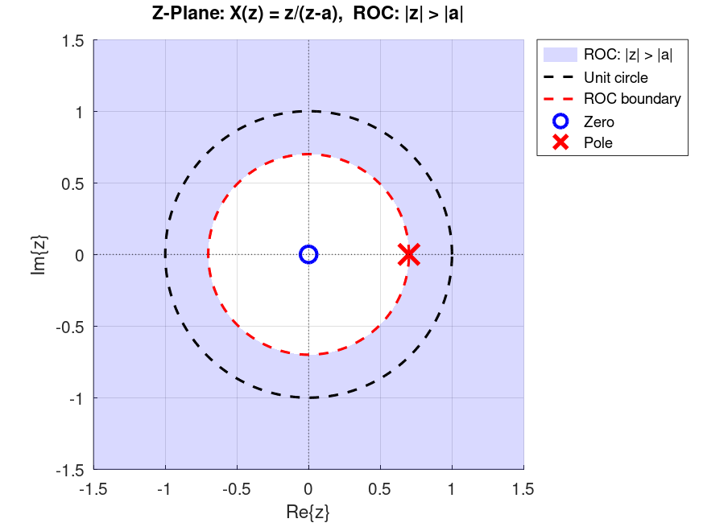

# Z-Transform 

In this chapter, we will introduce the *bilateral Z-transform*, which is often referred to as simply the *Z-transform*.
As we will see, the DTFT we talked about in the previous chapter is a special case of the bilateral Z-transform.
Afterwards, we will discuss a variant of it called the *unilateral Z-transform*, which allows us to solve linear constant-coefficient difference equations.
Lastly, we will discuss the relationship between the solution obtained via the *unilateral Z-transform* and the DTFT as well.

## Bilateral Z-transform
The bilateral Z-transform of a discrete-time signal \\(x[n]\\) is defined as
\\[
\boxed{X(z) = \sum_{n=-\infty}^{\infty} x[n]z^{-n}}
\\]
where \\(z\\) is a complex variable.

If we let
\\[
z=re^{j\omega},
\\]

then

\\[
X(re^{j\omega}) = \sum_{n=-\infty}^{\infty} x[n] (r e^{j\omega} )^{-n} = \sum_{n=-\infty}^{\infty} (x[n]r^{-n})e^{-j\omega n}
\\]

which means that the bilateral Z-transform is simply the DTFT of the signal \\(x[n]r^{-n}\\).
For \\(r=1\\), we get the actual DTFT.

The presence of \\(r\\) gives us an *extra degree of freedom*.
As a consequence, the bilateral Z-transform exists for signals such as exponentially growing signals, that normally do not have a DTFT.
For these signals, the extra degree of freedom (via an exponential) results in the signal to become well-behaved and causes the summation to have a finite value.

### Some Properties
The set of values of \\(z\\) for which the bilateral Z-transform converges is called the **Region of Convergence (ROC)**.

As an example, consider
\\[
x[n]=a^nu[n].
\\]

Its bilateral Z-transform is
\\[
X(z) = \sum_{n=-\infty}^{\infty} a^nu[n]z^{-n} = \sum_{n=0}^{\infty} (az^{-1})^n.
\\]

The geometric series converges if
\\[
|az^{-1}|<1,
\\]
or equivalently,
\\[
|z|>|a|.
\\]

Therefore,
\\[
X(z) = \frac{1}{1-az^{-1}} = \frac{z}{z-a}, \qquad |z|>|a|.
\\]

The ROC of the bilateral Z-transform is illustrated on the ***z-plane*** as depicted below (to have a concrete example the figure assumes \\(a = 0.8 \\)):

<figure style="text-align: center;">
  
  <figcaption>Figure 2: Z-plane for the expression X(z).</figcaption>
</figure>

As the figure shows, the shaded area, which is \\(|z| > 0.8\\), is the ROC of \\(X(z)\\) we computed earlier.
In the figure, you can also notice the location of the ***pole*** and the ***zero***. A zero is a root of the numerator of \\(X(z)\\), and a pole is a root of the denominator of  X(z), after simplifying X(z) and cancelling any common roots between the numerator and denominator.

> **Note:** A different sequence can result in the same bilateral Z-transform expression but have a different ROC.
> Consequently, when we refer to the Z-transform of a function, we should always specify its corresponding ROC as well.

Many other properties of the DTFT (such as linearity and convolution) carry over to the bilateral Z-transform as well.
Specifically, linearity holds just like it does for the DTFT.
The convolution of two signals also corresponds to the multiplication of their Z-transforms, with one small caveat: **the ROC of the resulting Z-transform is the intersection of the ROCs of the Z-transforms of each signal**.

## Unilateral Z-Transform
A related but different type of transform from the bilateral Z-transform, is called the ***unilateral Z-transform***.
One of the primary usages of the unilateral Z-transform is to solve linear constant-coefficient difference equations (LCCDEs).
The expression for the unilateral Z-transform is as follows: 
\\[
\boxed{X(z) = \sum_{n=0}^{\infty} x[n]z^{-n}}.
\\]

When applied to the signal \\(x[n]\\), the unilateral Z-transform can be thought of as the bilateral Z-transform of the signal \\(x[n]\\) multiplied by the unit step function, that is, the bilateral Z-tranform of \\(x[n]u[n]\\).
Furthermore, for a rational Z-transform, the ROC is the region **outside the outermost pole**.
Most properties are identical for the bilateral and unilateral Z-transforms, such as linearity.
The convolution property also holds provided both signals are zero for \\(n<0\\).

For the unilateral Z-transform, the time-shifting property is
\\[
\boxed{x[n-1] \Longleftrightarrow zX(z)-zx[-1]}.
\\]

This property allows us to *solve LCCDEs with initial conditions*.

### Solving LCCDEs via Unilateral Z-transform
One of the primary applications of the unilateral Z-transform is to find solutions to LCCDEs with initial conditions.
An LCCDE has the general form of:
\\[
\boxed{\sum_{k=0}^{N} a_k y[n-k] = \sum_{k=0}^{M} b_k x[n-k] , \qquad a_0 \neq 0}
\\]

An example of an LCCDE is as follows:

\\[
y[n] = 0.5y[n-1] + x[n]
\\]

with the initial condition \\(y[-1] = 0\\).

To solve this LCCDE via unilateral Z-transform, we can apply Z-transform on both sides of the equation and use the shifting property.
Note that, by doing so, we are implicitly assuming that \\(y[n]\\) and \\(x[n]\\) have valid Z-transforms.
\\(x[n]\\) is the input and the existence of its Z-transform is not up to us.
If we are dealing with reasonable, physical signals as input, then their Z-transform exists.
As for \\(y[n]\\), as long as the input is exponentially bounded, the solution \\(y[n]\\) to such LCCDE is exponentially bounded and has a valid Z-transform
(refer to [1], for the proof of this).
Hence, applying Z-transform to both sides and isolating \\(Y(z)\\) we get:

\\[
Y(z)=0.5z^{-1}Y(z) + 0.5z^{-1}y[-1] + X(z)
\\]

Since \\(y[-1]=0\\),

\\[
Y(z)(1-0.5z^{-1})=X(z)
\\]

and therefore,

\\[
Y(z)=\frac{X(z)}{1-0.5z^{-1}}=H(z)X(z)
\\]

where

\\[
H(z)=\frac{1}{1-0.5z^{-1}}.
\\]

To solve for \\(y[n]\\), assume that the input is just the step function \\(x[n]=u[n]\\), its unilateral Z-transform is:

\\[
X(z)=\frac{1}{1-z^{-1}}
\\]

hence,

\\[
Y(z) = \frac{1}{(1 - z^{-1}) (1 - 0.5z^{-1})} 
\\]

We can then do partial fraction decomposition to get:
\\[
Y(z) = \frac{2}{1 - z^{-1}} - \frac{1}{1 - 0.5z^{-1}}
\\]
Lastly, we can lookup Z-transform tables to find the inverse transform of each term \\(Y(z)\\) and obtain the time-domain signal.
The inverse is unique by the uniqueness theorem of the Z-transform, which states that the mapping between the time domain and the Z-transform domain is one-to-one.
This gives us

\\[
y[n]=(2-(0.5)^n)u[n].
\\]

### The Relation Between Unilateral Z-transform and DTFT
LCCDE with initial conditions are problems that, inherently, have solutions that are valid for \\(n \ge 0\\).
For the readers who are familiar with differential equations, this similar to initial value problems (IVPs) where the solutions are valid for example for \\(t \ge 0\\).
That being said, for LCCDEs, if we assume that \\(y[n]\\) and \\(x[n]\\) are zeros for \\(n<0\\), then the bilateral and unilateral Z-transform of those signals become the same (by the definition):

\\[
Y(z) = \sum_{n=-\infty}^{\infty} y[n]z^{-n} = \sum_{n=0}^{\infty} y[n]z^{-n}.
\\]

Therefore, the function \\(H(z)\\) found earlier can be evaluated on the unit circle, meaning that we replace \\(z=e^{j\omega}\\) and find the DTFT of the impulse response.
Hence, we can see that the system \\(Y(e^{j\omega}) = H(e^{j\omega}) X(e^{j\omega})\\) is merely doing frequency selective filtering on input signal \\(x[n]\\)!
This tells us how the LCCDE will shape the input signal if \\(x[n]\\) and \\(y[n]\\) are zero for \\(n<0\\).
For our previous example:
\\[
H(e^{j\omega}) = \frac{1}{1-0.5e^{-j\omega}}.
\\]

Plotting the magnitude of this function can show us that this is a low-pass filter (\\(|H(e^{j\omega})| = 1 / \sqrt{1.25 - \cos(\omega)} \\)).
We'll learn more about interpreting the function \\(H(e^{j\omega})\\) and its characteristics in the next chapter.

In summary, an LCCDE with zero initial conditions acts as a frequency-selective system whose frequency response is a rational function of the form
\\[
H(e^{j\omega}) = \frac{Y(e^{j\omega})}{X(e^{j\omega})} = \frac{\sum_{k=0}^{M} b_k e^{-j\omega k}}{\sum_{k=0}^{N} a_k e^{-j\omega k}}.
\\]
Such systems are also called ***frequency-selective digital filters***. 

> **Note 1:** We can replace \\(z = e^{j\omega}\\) in the Z-transform and get the DTFT of the signal only if the corresponding \\(x[n]\\) is absolutely summable:
> \\[
> \sum_{n=-\infty}^{\infty} |x[n]| < \infty.
> \\]
> (Because Z-transform of \\(x[n]\\) converges, if we have \\(\sum_{n=-\infty}^{\infty} |x[n]| |z|^{-n} < \infty \\), which for \\(z={e^{j\omega}}\\) is just the condition above.)
> 
> For the Z-Transform expressions that have a rational form, it can be shown that to safely do the substitution \\(z = e^{j\omega}\\) we can look at the poles (roots of the denominator of the Z-transform) and checking whether their magnitude is less than \\(1\\).

> **Note 2:** When someone hands us a Z-transform expression and asks us to find the time-domain equivalent, as we just saw with the example, if the expression was obtained via unilateral Z-transform, then there is one unique signal in the time-domain that gives us that Z-transform expression.
> As we briefly mentioned in the previous subsection, this is not the case if the expression was obtained via bilateral Z-transform.
> For instance, if the expression \\(H(z) = \frac{1}{1-0.5z^{-1}} \\) is obtained via bilateral Z-transform, both the signal
> \\[
>   h[n] = (0.5)^{n} u[n]
> \\]
> as well as
> \\[
>   h[n] = (0.5)^{n} u[-n-1]
> \\]
> are valid time-domain signals that give us that Z-transform. The only thing that differentiates them is their corresponding ROC.
> For the first case, the ROC is \\( |z| > 0.5 \\) and for the latter is \\( |z| < 0.5 \\).
> Since, by definition, the sum in the unilateral Z-transform is from \\(n = 0\\) until \\(n = \infty \\), only the first sequence can give us that Z-transform expression.

# References
[1] Kelley, Walter G., and Allan C. Peterson. *Difference equations: an introduction with applications*. Academic Press, 2001
