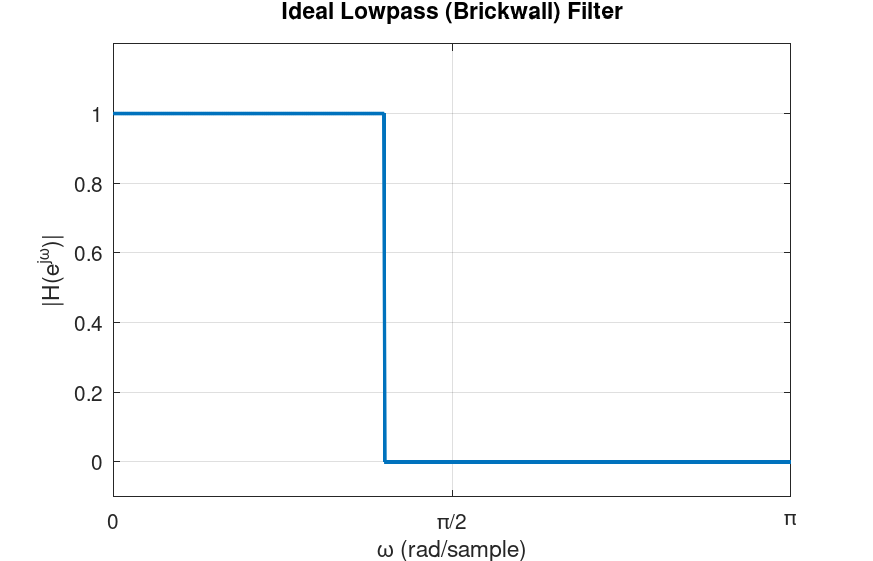
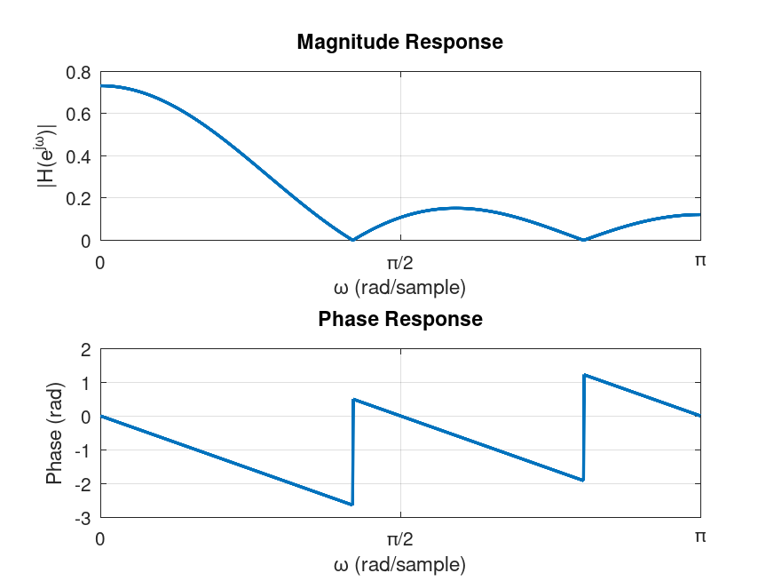

In the code above TransferFunction receives the numerator and denominator coefficients as the first and second argument in the `::new(...)` function.

Note that for a given set of coefficients of a filter, to obtain the output, we can either plug in \\(x[n]\\) in the LCCDE expression, which is exactly how `.filter()` computes the output in LibreDSP.
As we saw in the previous chapter, mathematically, an equivalent way is to find the output of the filter for the delta or impulse function \\(\delta[n]\\) which is called the **impulse response**.
Afterwards, convolving an arbitrary input signal \\(x[n]\\) with the impulse response gives us the output of the filter, \\(y[n]\\).


As a concrete example of a frequency-selective filter, assume that we want to have a filter that passes low frequencies of the input and blocks the others.
The DTFT of the impulse response of such filter would ideally be:

\\[
H(e^{j\omega}) =
\begin{cases}
1, & |\omega| < \omega_c \\\\
0, & \omega_c < |\omega| \leq \pi
\end{cases}
\\]

where \\(\omega_c\\) is the cutoff frequency, between \\(0\\) and \\(\pi\\).
This is also called the "brick-wall" filter, because it completely passes frequencies before a certain cutoff frequency and blocks the others.

The graph of this function is depicted below:
<figure style="text-align: center;">
  
  <figcaption>Figure 1: The graph of an ideal low-pass filter.</figcaption>
</figure>

A few notes about the ideal low-pass filter.
Firstly, as the figure shows, we typically plot the DTFT of the impulse response only from \\(0\\) to \\(\pi\\), because the DTFT is \\(2\pi\\)-periodic and, for real-valued signals and systems, we have \\(H(e^{-j\omega}) = H^*(e^{j\omega})\\), so we only plot from \\(0\\) to \\(\pi\\).
Moreover, the DTFT of the impulse response we saw above is in its **ideal** form.
It can be mathematically shown that such a filter is practically not realizable.
Specifically, the output of such a filter is computed by convolving the input signal \\(x[n]\\) in the time domain with the impulse response of this filter.
The inverse DTFT of the ideal low-pass filter is "sinc-like":
\\[
h[n] = \frac{1}{2\pi} \int_{-\pi}^{\pi} H(e^{j\omega}) e^{j\omega n} d\omega
= \frac{1}{2\pi} \int_{-\omega_c}^{\omega_c} e^{j\omega n} d\omega
= \frac{\sin(\omega_c n)}{\pi n}
\\]

For \\(n \neq 0 \\) and \\(h[0] = \omega_c / \pi \\).
This function has infinite length, therefore, to compute the convolution needed to obtain the filter's output, we need infinite computations.
That being said, the filters we can design in practice can have characteristics that are very close to the ideal cases, such as the low-pass in this example.


There are numerous techniques for designing frequency-selective filters.
The LibreDSP library supports the most commonly used methods including:

1. The windowing method
2. Zero-pole placement method
3. Analog-to-digital transformation
4. Least-squares linear phase FIR filters
5. Parks-McClellan algorithm

Some of these methods, specifically, methods 1, 4 and 5, design ***finite-impulse response (FIR)*** filters and the rest give us ***infinite-impulse response (IIR)*** filters.
Moreover, methods 1, 4 and 5 are said to have ***linear phase*** and the rest do not have this property.
In the rest of this chapter we briefly talk about these differences.

## FIR vs IIR Filters
A filter is said to be of type finite impulse response (FIR) if, in the LCCDE, the output \\(y[n]\\) depends only on the **current and past input terms \\(x[n], x[n-1], x[n-2], \dots\\)**, and not on any past output terms \\(y[n-k]\\) for \\(k \geq 1\\).
The word "finite" in FIR comes from the fact that if the input is the unit impulse \\(\delta[n]\\), the output has finite duration that is determined by the number of \\(x\\) terms.
An example of an FIR filter is as follows:

\\[
y[n] = x[n] + 0.4x[n-1] + 0.6x[n-2]
\\]

A filter is said to be of type infinite impulse response or IIR if the output also depends on previous output as well, meaning terms such as \\(y[n-1]\\), \\(y[n-2]\\), ..., are also present.
These terms are also called *feedback* terms.
Lastly, the word infinite in IIR stands for the infinite duration that such filters have due to delta or impulse input.

## Linear Phase Filter
Having linear phase is a property that a filter can have.
To understand what this property means, consider a filter when the input is \\(x[n] =\cos{\omega_0 n }\\).
For this input, the output of the filter can be shown to be:

\\[
y[n] = |H(e^{j\omega_0})| \cos\big(\omega_0 n + \angle H(e^{j\omega_0})\big)
\\]

where \\(H(e^{j\omega})\\) is the DTFT of the impulse response of the filter.
What the expression above shows us is that for a pure cosine signal, the output is cosine in the same frequency but with its amplitude and phase changed by the filter.
Why is the output of a filter for this particular input important?
As we have discussed, for a real-valued signals (the ones we mostly deal with), their DTFT have this property:

\\[
X(e^{-j\omega}) = X^*(e^{j\omega})
\\]

As a consequence, in the reconstruction formula of the DTFT, for a particular frequency \\(\omega_0\\), we would have:

\\[
A e^{j\omega_0 n} + A^* e^{-j\omega_0 n}
\\]

where \\(A\\) is some complex amplitude.

Now, writing \\(A = |A| e^{j\phi}\\).
Then \\(A^* = |A| e^{-j\phi}\\).
The pair becomes:

\\[
|A| e^{j\phi} e^{j\omega_0 n} + |A| e^{-j\phi} e^{-j\omega_0 n}
= |A| \left( e^{j(\omega_0 n + \phi)} + e^{-j(\omega_0 n + \phi)} \right)
= 2|A| \cos(\omega_0 n + \phi)
\\]

Therefore, repeating the process above for any arbitrary frequency results in expressing any real-valued signal as a sum of real-valued cosine terms.
As a consequence, knowing how the filter behaves for sinusoidal signals tells us everything we need to know about how the filter affects an arbitrary input.

Now, by definition, a filter is said to have linear phase if its frequency response has the following form:

\\[
\boxed{H(e^{j\omega}) = A(\omega) e^{-j\alpha\omega}}
\\]

where \\(A(\omega)\\) is a real-valued function and \\(\alpha\\) is just a constant value.
Substituting this expression into the expression for the output of a filter for a cosine input, for \\(A(\omega_0) \ge 0\\):

\\[
y[n] = |A(\omega_0)| \cos\big(\omega_0 n - \omega_0 \alpha\big)
= |A(\omega_0)| \cos\big(\omega_0 (n - \alpha)\big)
\\]

For \\(A(\omega_0) \le 0\\) we get an additional \\(\pi\\) phase shift, or equivalently:
\\[
y[n] = -|A(\omega_0)| \cos\big(\omega_0 (n - \alpha)\big)
\\]

The result of the above expressions tell us that the output of the linear phase filters due to different sinusoidal inputs, is the same sinusoid, scaled, shifted by the same amount in time or possibly with a \\(\pi\\) deviation.

It can be proved that filters whose impulse response is symmetric around some index or antisymmetric have linear phase.
Mathematically, a symmetric filter is a filter whose impulse response is:
\\[
\boxed{h[n]=h[M-n] \\: \\: \\: \\: \\: \text{for } 0 \leq n \leq M}
\\]

Where \\(M\\) is some index.
Antisymmetric filters have the following definition:


\\[
\boxed{h[n]=-h[M-n] \\: \\: \\: \\: \\: \text{for } 0 \leq n \leq M}
\\]

Moreover, the impulse response of a symmetric and antisymmetric filter, can each be odd or even length.
Therefore, depending on the symmetry and even or odd length of the impulse response we have the following four types of linear phase filters:

- Type I: Symmetric, odd length
- Type II: Symmetric, even length
- Type III: Anti-symmetric, odd length
- Type IV: Anti-symmetric, even length

Each of the four type has certain characteristics.
For instance, for Type II filters, \\(A(\omega)\\) is always zero at \\(\omega=\pi\\).
Consequently, they are not suited for highpass filters.
In contrast, Type I filters do not have a forced zero at any frequency. 
Type III filters have \\(A(0)=0\\) and \\(A(\pi)=0\\).
Consequently, they cannot be used for lowpass or highpass filters, but are well-suited for bandpass filters.
Type IV filters, on the other hand, always have \\(A(0)=0\\) but no forced zero at \\(\omega=\pi\\).
Hence, they are suitable for highpass filters.


### An example of a filter with symmetric impulse response
We shall now see a simple example of a linear phase filter that has a symmetric impulse response.
Assume the impulse response of the filter is symmetric with the values:

\\[
h[n] = [0.1339, 0.1526, 0.1592, 0.1526, 0.1339]
\\]

Applying the DTFT:

\\[
    H(e^{j\omega}) = 0.1339 + 0.1526 e^{-j\omega} + 0.1592 e^{-j2\omega} + 0.1526 e^{-j3\omega} + 0.1339 e^{-j4\omega}
\\]

Factoring out \\(e^{-j2\omega}\\):

\\[
    H(e^{j\omega}) = e^{-j2\omega} \Big[ 0.1339 e^{j2\omega} + 0.1526 e^{j\omega} + 0.1592 + 0.1526 e^{-j\omega} + 0.1339 e^{-j2\omega} \Big] 
\\]

Pairing symmetric terms using \\(e^{j\theta} + e^{-j\theta} = 2 \cos(\theta) \\):

\\[ 
    H(e^{j\omega}) = e^{-j2\omega} \Big[ 0.1592 + 2 \cdot 0.1339 \cos(2\omega) + 2 \cdot 0.1526 \cos(\omega) \Big]
\\]

Finally, we get:

\\[
    A(\omega) = 0.1592+ 2 [ 0.1339 \cos(2\omega)+0.1526 \cos(\omega)]
\\] 

which is the real-valued function, and:

\\[
    H(e^{j\omega}) = A(\omega) e^{-j2\omega}
\\]

As a final remark in this subsection, for physically realizable filters, only FIR filters can have linear phase.
Practical IIR filters do not have linear phase.
Therefore, for applications where the linear phase property of the filter is desired, FIR filters should be used.
It should also be noted that even though practical IIR filters are not linear phase, but with a small number of filter coefficients, we often can get a decent filter with sharp transitions between passband and stopband areas.
This is in contrast to FIR filters that we often need 10, 20 or even more number of coefficients to produce a good filter.
The magnitude and phase of this filter is depicted below:

<figure style="text-align: center;">
  
  <figcaption>Figure 2: The graph of the linear phase filter.</figcaption>
</figure>

As the figure shows, the filter is a low-pass filter.

## Filter Design in LibreDSP
In LibreDSP, both FIR and IIR filters with various techniques can be designed.
The summary of each method is briefly mentioned below:

1. **The windowing method:** In this method, the program first obtains the impulse response of the ideal filter we would like to design, then shifts it in time by half the filter length, and multiplies the signal, element-wise, with a "window" function.
This results in a causal and realizable filter.
The act of multiplying the impulse response by the window function in time, corresponds to convolution of the spectrum of the window with the ideal filter.
Therefore, the larger the number of filter weights are, the larger the window would be, and the narrower its spectrum is.
As a consequence, we get a filter whose frequency response is closer to the desired frequency response.

2. **Zero-pole placement method:** The program receives the locations of the poles and zeroes of the Z-transform function of the desired filter, and then it gives the filter coefficients that correspond to that transfer function.
This method, can be helpful to visually design filters.
For instance, putting poles near \\(\omega=0\\) and zeros around \\(\omega=\pi\\) will design a low pass filter.

3. **Analog-to-digital transformation:** For this method, the program after receiving the desired filter specification, constructs an analog filter and then discretizes it using bilinear transform.
This method gives us great filters with a very few coefficients like 3 or 4.
However, as we discussed in the last subsection, they do not have linear phase.

4. **Least-squares linear phase FIR filters:** The program finds the FIR filter coefficients that minimizes the square error between the designed filter and the desired filter.
The program additionally can accept weighting that can weight the importance of different regions of the desired frequency segments.

5. **Parks-McClellan algorithm:** The program designs a 'equiripple' FIR filter using the Parks-McClellan algorithm which is essentially the Remez exchange algorithm applied to the filter design problem. The 'equiripple' property of the filter means that the errors between the designed filter and the desired filter attains a fixed maximum value related to the filter length.

The following code snippet designs a filters via LibreDSP using different methods:

```rust
use libredsp::filter_design::frequency_selective::*;
use libredsp::types::*;
use std::f64::consts::PI;
use libredsp::window::*;
fn main() {
    /* Windowing method: */

    let coefs = windowing_method(6, WindowType::Rectangular, FilterType::Lowpass { w: 0.5 });
    println!("coef {:?}", coefs);

    /* Analog-to-digital transform: */

    let coefs_iir: TransferFunction = analog_to_digital_transform_iir_filter_design(
        AnalogToDigitalTransformationDesignMethod::Butterworth,
        FilterType::Highpass { w: 0.5 },
        3,
        0.2,
    );
    println!("coef {:?}", coefs_iir);

    let fir_ls_lp = least_squares_linear_phase_fir(
        vec![0.0, 0.15, 0.85, 1.0],
        vec![1.0, 1.0, 0.0, 0.0],
        vec![1.0, 100.0],
        11,
    );
    println!("coef {:?}", fir_ls_lp);

    /* Zero-pole placement method: */
    let iir_pole_placement = zero_pole_placement_iir_filter_design(
        &vec![(0.47, -0.495), (0.47, 0.495)],
        &vec![(-0.469, -0.605), (-0.469, 0.605)],
    );
    println!("coef {:?}", iir_pole_placement);

    /* Parks-McClellan: */
    let num_taps = 11;
    let target = |f: f64| {
        if f <= 0.18 * PI { 1.0 } else { 0.0 }
    };

    let weight = |f: f64| {
        if f <= 0.18 * PI { 1.0 } else { 10.0 }
    };

    let coefficients =
        parks_mcclellan_filter_design(num_taps, target, weight, LinearPhaseFilterType::I);
    println!("{:?}", coefficients);
}
```

The output of the program is as follows:
```
coef TransferFunction { num: [0.12082847447089783, 0.14464823741432514, 0.15750225222345277, 0.15750225222345277, 0.14464823741432514, 0.12082847447089783], den: [1.0] }
coef TransferFunction { num: [0.6032341794887927, -1.8097025384663779, 1.8097025384663779, -0.6032341794887927], den: [1.0, -2.008975131286557, 1.4531076859873064, -0.363790618636477] }
coef TransferFunction { num: [0.01096242712052965, 0.015243639397498555, 0.01919520737126291, 0.02239463734598537, 0.024471842004575785, 0.025195158597253242, 0.024471842004575785, 0.02239463734598537, 0.01919520737126291, 0.015243639397498555, 0.01096242712052965], den: [1.0] }
coef TransferFunction { num: [1.0, 0.938, 0.5859859999999999], den: [1.0, -0.94, 0.465925] }
TransferFunction { num: [0.16995125386133128, 0.18332484242715108, 0.09773115654870167, 0.20681141920227245, 0.18226295845770424, 0.20848282286228859, 0.18226295845770424, 0.20681141920227245, 0.09773115654870167, 0.18332484242715108, 0.16995125386133128], den: [1.0] }
```
The above example shows the filter coefficients of various filters.

LibreDSP Workspace also provides a graphical user interface to design and visualize filters.