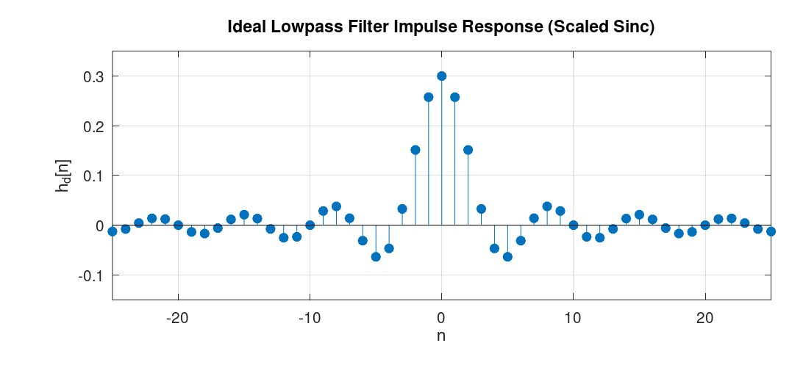
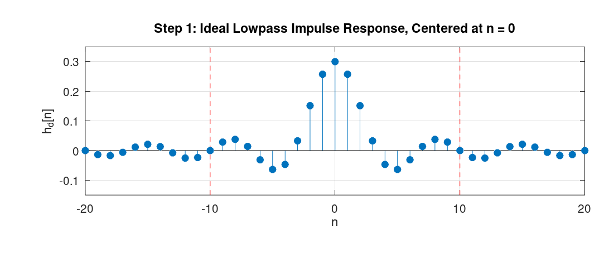
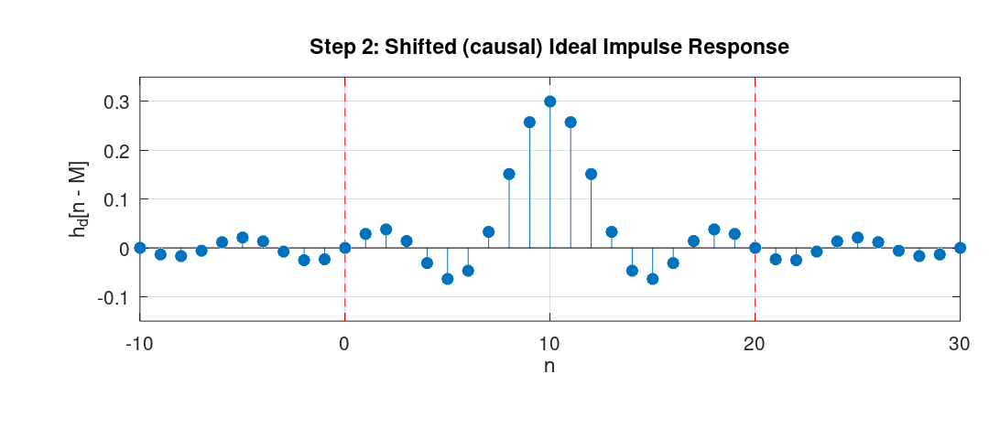
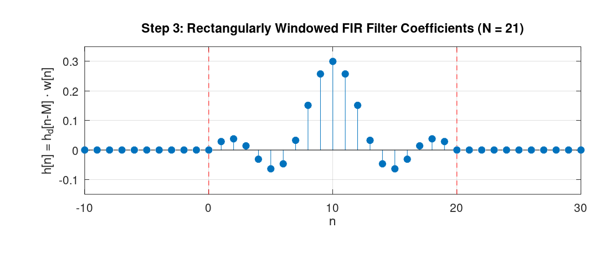
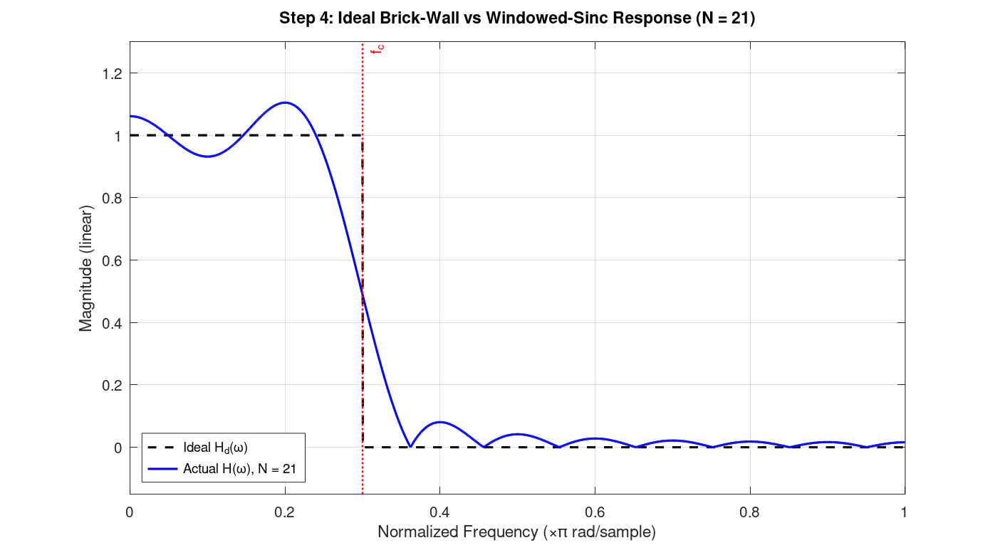
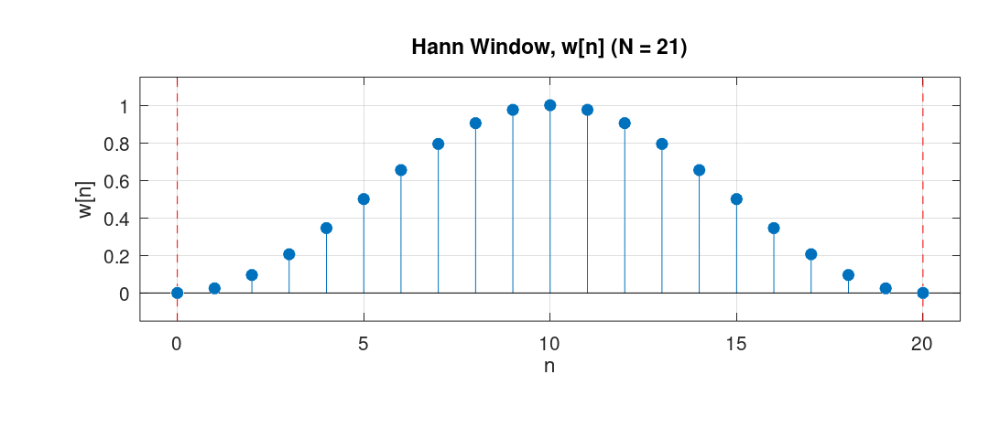
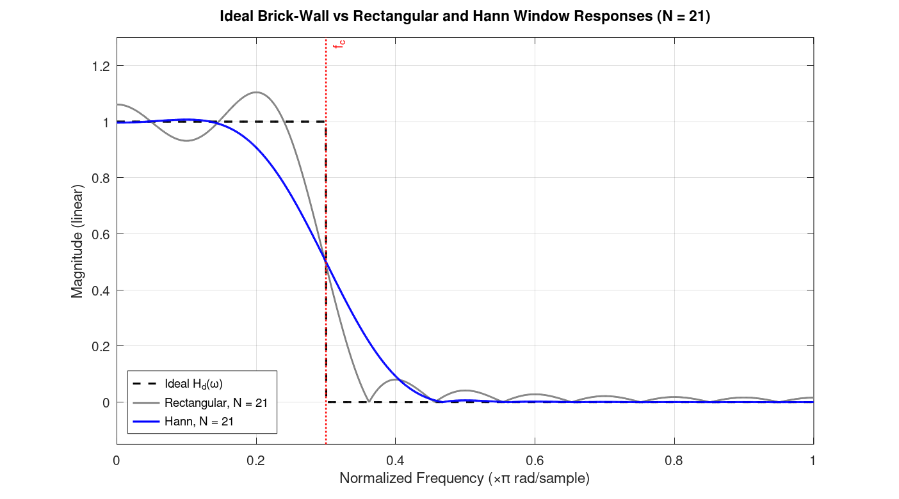

# Chapter 8 - Digital Fitler Design: The Windowing Method

The last chapter introduced a several digital filter design techniques.
In this chapter, we will look at the windowing method in detail.
The windowing method is the simplest filter design techniques and can provides a basis to understand other filter design techniques.
The windowing method allows us to design FIR filters with linear phase.

Before understanding how the windowing method works, let us first compute the impulse response of an ideal filter, and see if we can directly convolve this impulse response with an arbitrary input \\(x[n]\\) (remember, from the convolution theorem, doing so would perform frequency-selective filtering).

Let us assume we would like to perform lowpass filter.
The impulse response of such filter has the following DTFT:

\\[
H(e^{j\omega}) =
\begin{cases}
1, & |\omega| < \omega_c \\\\
0, & \omega_c < |\omega| \leq \pi
\end{cases}
\\]

where \\(\omega_c\\) is the cutoff frequency, between \\(0\\) and \\(\pi\\).

The inverse DTFT of this expression yields:

\\[
h[n] = \frac{1}{2\pi} \int_{-\pi}^{\pi} H(e^{j\omega}) e^{j\omega n} d\omega
= \frac{1}{2\pi} \int_{-\omega_c}^{\omega_c} e^{j\omega n} d\omega
= \frac{\sin(\omega_c n)}{\pi n}
\\]

For \\(n \neq 0 \\) and \\(h[0] = \omega_c / \pi \\).
As a reminder from [Chapter 2](./2_dfs_and_dtft.md), the graph of this function is depicted below:

<figure style="text-align: center; display: flex; flex-direction: column; align-items: center; gap: 12px;">
  
  <figcaption>Figure 1: The plot of impulse response for an ideal lowpass filter.</figcaption>
</figure>

As we can see from the graph, the impulse response of such ideal filters has infinite length and is non-causal.
Having infinite length means that we would require infinite computation to calculate the output of such filters via convolution.
Furthermore, the non-causal nature of the impulse response means that if the input signal \\(x[n]\\) is being generated in real time, then its convolution with the impulse response \\(h[n]\\) requires access to **future samples** of the signal, which is physically not realizable.
To understand this visually: the convolution of \\(x[n]\\) with the impulse response \\(h[n]\\) means that we fix the graph of \\(x[n]\\), flip \\(h[n]\\) with respect to the y-axis to get \\(h[-n]\\), shift this flipped signal, and perform element-wise multiplication and addition of the result.
Now, imagine \\(x[n]\\) is a signal generated in real time, sample by sample, and we try to compute the convolution "on the fly" as each new sample arrives.
If \\(h[n]\\) has non-zero values for any \\(n < 0\\), then when it is flipped around the y-axis, the convolution involves element-wise multiplication of some non-zero elements of \\(h[n]\\) with elements of \\(x[n]\\) that are not yet available.
Therefore, the impulse response of the ideal filter we derived is not realizable.
**Both because of computational constraints and because it is physically unrealizable.**

Note that the non-causal nature of the impulse response can be made realizable if all samples of the signal are available in advance and we perform the convolution offline.
However, the infinite length of the filter still makes it computationally intractable.

**The windowing method** is a filter design technique that works as follows: after we derive the impulse response of an ideal filter, we shift it by an integer number of samples, we then apply "windowing", that is, we multiply the impulse response, element-wise, with a *window function*.

A window function, in its basic form, is simply a rectangular function defined as:
\\[
w[n] =
\begin{cases}
1, & 0 \leq n \leq M \\\\
0, & \text{otherwise}
\end{cases}
\\]
When this function is used as the window function, its effect is simply **truncating** the shifted impulse response.

To determine the spectrum of the impulse response of the filter designed via the windowing method, we should investigate what happens in the frequency domain when we multiply the shifted impulse response, element-wise, by the window function in the time domain.
The answer lies in the use of the *convolution theorem*.
The theorem tells us that just as multiplication in the frequency domain corresponds to convolution in the time domain, the converse is also true: ***multiplication in the time domain***, as is the case here, corresponds to (periodic) ***convolution in the frequency domain***.

A small note before deriving the frequency characteristic of the filters designed via the windowing method:
In the process of designing filters via the windowing method, we can use different window types, such as *Hann*, *Hamming*, *Bartlett*, and others.
Each of these window types has its own distinct effect on the resultant filter.
However, a property that is common among all of them is that they are *symmetric* around some index.
Consequently, as we saw in [Chapter 4](./4_linear_phase_filters.md), the resulant filter will have linear phase.

## A Concrete Example
In this subsection we'll see concrete steps to design an FIR filter with the windowing method with a filter size of \\(21\\) and with a cutoff frequency of \\(\omega_c = 0.3\\) radians/samples.
For simplicity, we will use the rectangular window for the design.
Once we design the filter, we would also like to observe the spectrum of the filter's impulse response.
- **Step 1**: We would like to design a low-pass filter using the windowing method with a filter size of \\(21\\).
To this end, we analytically find the expression for the ideal low-pass filter.
As we derived at the beginning of this chapter, its impulse response is the sinc-like function.
The following graph shows this infinite-length sequence (the red dots denote the desired filter size):

<figure style="text-align: center; display: flex; flex-direction: column; align-items: center; gap: 12px;">
  
  <figcaption>Figure 2: The impulse response of the ideal low-pass filter.</figcaption>
</figure>

- **Step 2**: We shift the ideal impulse response by half the size of the desired filter (10 samples, since the filter length is 21).
<figure style="text-align: center; display: flex; flex-direction: column; align-items: center; gap: 12px;">
  
  <figcaption>Figure 3: Shifted impulse response of the ideal low-pass filter.</figcaption>
</figure>

- **Step 3**: We apply the rectangular window with length 21 to the sequence, starting from index \\(0\\) to index \\(20\\).
This gives us the filter coefficients of the desired filter.

<figure style="text-align: center; display: flex; flex-direction: column; align-items: center; gap: 12px;">
  
  <figcaption>Figure 4: The truncated impulse response after applying the rectangular window.</figcaption>
</figure>

The following graph depicts the frequency response of the designed filter.

<figure style="text-align: center; display: flex; flex-direction: column; align-items: center; gap: 12px;">
  
  <figcaption>Figure 5: Frequency response of the designed low-pass filter.</figcaption>
</figure>

(The script that generated this graph, appended zeros to the sequence, which is referred to as **"zero-padding"**, and then applied the DFT to the resulting sequence.
From the definition of the DTFT, zero-padding and computing the DFT gives us samples of the DTFT.
As we append more zeros, the result gets closer to the actual DTFT plot.
Also, for computing the DFT, we typically use an efficient algorithm, such as the **Fast Fourier Transform (FFT)**.
We will learn about the FFT in [Chapter 12](./12_fast_fourier_transform.md))

As we can see, it has values close to 1 from frequency \\(0\ \text{rad/sample}\\) up to the cutoff frequency \\(\omega_c = 0.3\\) radians/samples, then decreases and reaches approximately zero.
An interesting observation that can be made about the shape of the graph is that, from the convolution theorem we mentioned earlier, we know that this spectrum is the result of convolving the spectrum of the ideal filter with the spectrum of the rectangular window.
The spectrum of the ideal filter is just a rectangle function in the frequency domain.
The spectrum of the rectangular window (in the time domain) is a sinc-like function in the frequency domain.
Consequently, the shape we see in Figure 4 is exactly the result of convolving the rectangle function with the sinc-like function.

### A Few Remarks
In the example above, we chose a filter length of 21.
The larger we choose this number, the closer the spectrum will be to the desired one.
Specifically, the longer the rectangular function is, the more concentrated its spectrum (the sinc-like function) is around the origin.
As a result, its spectrum gets convolved with a sinc-like function that has more "energy" around its point of symmetry.
The resulting function has less deviation from the ideal low-pass filter in the passband and stopband regions (except at the discontinuities, in this example at \\(\omega_c = 0.3\\) radians/samples, because of what's known as the "Gibbs phenomenon").

Furthermore, in the example we used the rectangular window.
For comparison, we could have used another window such as the Hann window.
The Hann window has the following definition:
\\[
w[n] = 0.5 - 0.5 \cos \left(\frac{2\pi n}{N-1}\right), \quad 0 \leq n \leq N-1
\\]
Below is the graph of that function for \\(N = 21\\):

<figure style="text-align: center; display: flex; flex-direction: column; align-items: center; gap: 12px;">
  
  <figcaption>Figure 5: The Hann window function for N = 21.</figcaption>
</figure>

For the design of the filter in the example, If we had used the Hann window, we would have obtained the following spectrum:

<figure style="text-align: center; display: flex; flex-direction: column; align-items: center; gap: 12px;">
  
  <figcaption>Figure 6: Frequency response of the filter designed using the Hann window.</figcaption>
</figure>

The figure shows the spectrum of the filter design by applying Han window, alongside the one obtained by applying the rectangular window as well as the ideal spectrum. 

Among the window functions that are used in practice, a window called the *Kaiser window* has particular importance.
Mathematically, it is defined as:
\\[
w[n] =
\begin{cases}
\dfrac{
I_0\\\!\left(
\beta\sqrt{ 1-\left(\dfrac{2n}{N-1}-1\right)^2 }\right)}{I_0(\beta)},
& 0 \le n \le N-1, \\\\[1.2em] 0, & \text{otherwise}.\end{cases}
\\]

In this equation, \\(I_0\\) is the zeroth-order modified Bessel function of the first kind, and \\(\beta\\) is a parameter that is determined by the *desired minimum stopband attenuation* (in dB) and the *transition width* between the passband and stopband.
Therefore, as a user, we simply provide the minimum stopband attenuation and transition width, and \\(\beta\\) is computed by the software automatically.

## Characteristics of Filters Designed via the Windowing Method
In this section, we look at the actual formulas that tells us the spectrum of the impulse response of the filter designed via the windowing method.
This section derives these expressions by applying the convolution theorem for the windowing method.

Assume the desired impulse response is symmetric and has length \\(M+1\\). Since it is symmetric about \\(M/2\\), its DTFT will be:

\\[
D(e^{j\omega}) = A(e^{j\omega})\ e^{-j\omega M/2}
\\]

where \\(A(e^{j\omega})\\) is a real and even function (due to the symmetry), and \\(e^{-j\omega M/2}\\) denotes a delay of \\(M/2\\) samples in time.

Assume the window function is rectangular. Since it is also symmetric, the DTFT of this function is:

\\[
W(e^{j\omega}) = B(e^{j\omega})\ e^{-j\omega M/2}
\\]

where \\(B(e^{j\omega})\\) is also real and even.

Since the window function multiplies the impulse response in time, in the frequency domain this becomes a periodic convolution:

\\[
H(e^{j\omega}) = \frac{1}{2\pi} \int_{-\pi}^{\pi} W(e^{j\theta}) D(e^{j(\omega-\theta)}) d\theta
\\]

Substituting the two expressions into the definition of periodic convolution gives:

\\[
H(e^{j\omega}) = e^{-j\omega M/2} \cdot \frac{1}{2\pi} \int_{-\pi}^{\pi} B(e^{j\theta}) A(e^{j(\omega-\theta)}) d\theta
\\]

(because in the convolution, the expression \\(e^{-j\theta M/2} e^{-j(\omega-\theta) M/2} = e^{-j\omega M/2}\\)).

The integral is a periodic convolution of two real and even functions, so the result is also real and even. Hence:

\\[
H(e^{j\omega}) = C(e^{j\omega}) e^{-j\omega M/2}
\\]

where \\(C(e^{j\omega})\\) is real and even, and \\(e^{-j\omega M/2}\\) denotes a delay of \\(M/2\\) samples in time.